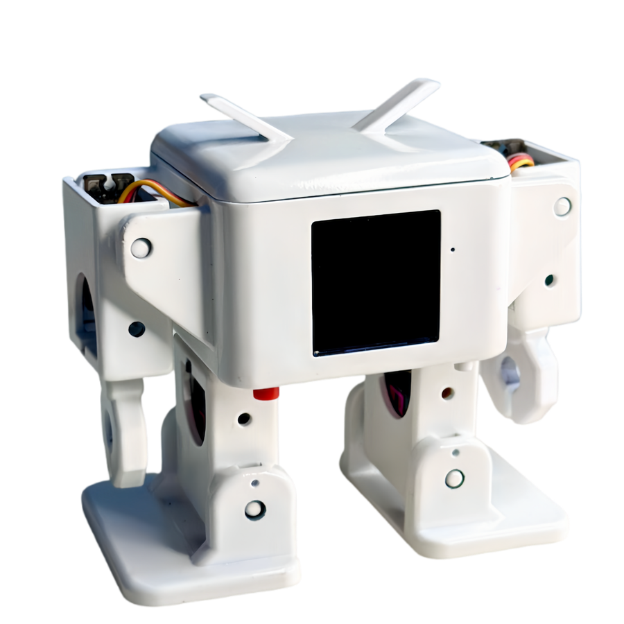

# 闪猫1号 Otto 摄像头版固件

<p align="center">
  
</p>

<p align="center">
  <b>会听、会说、会看、会动的 AI 桌面人形机器人</b><br>
  ESP32-S3 · 六舵机 · 1.54 英寸屏幕 · OV2640 / OV3660 / GC2145 摄像头
</p>

---

## 这是什么

这是 **闪猫1号（Shanmao 1）Otto 摄像头版** 的独立固件仓库。

项目从 [xiaozhi-esp32](https://github.com/78/xiaozhi-esp32) 的 `otto-robot` 板级提取，移除了其他板卡，只保留闪猫1号 Otto 摄像头版需要的代码、配置、资源、构建脚本和文档。

> 闪猫1号是闪猫科技推出的 AI 桌面人形机器人 DIY 套件：30 分钟即可完成组装，支持语音对话、离线唤醒、表情、六舵机动作、摄像头视觉和 MCP 扩展。  
> 产品介绍：[shanmaotech.cn](https://shanmaotech.cn/) · [闪猫1号详情](https://shanmaotech.cn/ottodiy/)

## 功能

- **离线语音唤醒**：默认“你好小智”，支持切换 ESP-SR 预训练唤醒词；
- **AI 语音对话**：WebSocket 实时语音链路，支持主流大模型服务端；
- **六舵机动作**：行走、转向、跳跃、摇摆、太空步、坐下、展示等；
- **表情系统**：1.54 英寸 ST7789 屏幕，双眼睛 GIF 表情和拍照预览；
- **摄像头视觉**：自动识别 OV2640 / OV3660 / GC2145，支持拍照识图；
- **MCP 工具**：语音或小程序调用 `self.otto.action`、`self.camera.take_photo` 等；
- **配网与电池**：Wi-Fi 配网、电池电量、USB/充电状态上报；
- **硬件自适应**：保留 Otto 摄像头/无摄像头版本的硬件识别；未安装摄像头时自动跳过摄像头初始化。

## 硬件

| 项目 | 规格 |
|---|---|
| 主控 | ESP32-S3，16MB Flash |
| 屏幕 | ST7789 240×240，SPI |
| 舵机 | 6 路：左/右腿、左/右脚、嘴巴、脖子 |
| 麦克风 | I2S 数字麦克风，16kHz |
| 扬声器 | I2S 功放，16kHz |
| 摄像头 | OV2640 / OV3660 / GC2145，自动探测 |
| 供电 | 锂电池 + USB 充电/检测 |
| 交互 | 语音、MCP、WebSocket、小程序 |

### 舵机引脚

| 关节 | GPIO | 安全范围 |
|---|---:|---|
| 左腿 | 5 | 0～180°，正常 75～105° |
| 右腿 | 43 | 0～180°，正常 75～105° |
| 左脚 | 6 | 0～180°，正常 80～100° |
| 右脚 | 44 | 0～180°，正常 80～100° |
| 嘴巴 | 4 | **45～60°，不能超过 60°** |
| 脖子 | 7 | **45～180°，135° 为正前方** |

> 不同批次硬件可能有差异，改引脚或限位前请先核对板子丝印和 `main/boards/otto-robot/config.h`。

### 摄像头

| 型号 | PID | 说明 |
|---|---|---|
| OV2640 | `0x2640` / `0x2626` | 预览使用统一 270° 旋转 |
| OV3660 | `0x3660` | 预览使用统一 270° 旋转 |
| GC2145 | `0x2145` | 额外关闭 hmirror/vflip |

摄像头方向已经统一处理：Otto 预览路径默认 270°，GC2145 单独关闭板级 hmirror/vflip。若更换模组后方向仍不对，先确认是传感器翻转还是预览旋转问题，不要同时改两层。

## 环境要求

- ESP-IDF **6.0.1+**（推荐 `release/v6.1`）
- Python **3.10+**
- Git、CMake、Ninja
- 一根能传数据的 USB-C 线

安装 ESP-IDF：

```bash
mkdir -p ~/esp
cd ~/esp
git clone -b v6.0.1 --recursive https://github.com/espressif/esp-idf.git esp-idf-v6.0.1
cd esp-idf-v6.0.1
./install.sh esp32s3
source export.sh
```

如果源码放在中文路径下，ESP-IDF 6.0.1 在 macOS 上可能报 `picolibc.specs` 错误。把仓库复制到纯 ASCII 路径再构建，例如：

```bash
cp -R /path/to/shanmaootto ~/shanmaootto-build
cd ~/shanmaootto-build
```

## 编译

```bash
source ~/esp/esp-idf-v6.0.1/export.sh
cd shanmaootto

python3 scripts/build.py otto-robot \
  --name otto-robot \
  --language zh-CN \
  --wake-word wn9_nihaoxiaozhi_tts
```

产物：

```text
build/xiaozhi.bin          # app
build/generated_assets.bin # 表情/语音资源
build/merged-binary.bin    # 完整合并镜像
build/flash_args           # 本次构建的烧录地址表
```

## 烧录

### 首次烧录 / 彻底恢复

```bash
python -m esptool --chip esp32s3 -p /dev/cu.usbmodemXXXX -b 460800 \
  write_flash 0x0 build/merged-binary.bin
```

> 从 `0x0` 写入完整镜像会覆盖 NVS，Wi-Fi 配网信息会丢失。

### 只更新 app，保留 Wi-Fi

先查看本次构建的 app 地址：

```bash
cat build/flash_args
```

再写入对应地址，例如：

```bash
python -m esptool --chip esp32s3 -p /dev/cu.usbmodemXXXX -b 460800 \
  write_flash 0x20000 build/xiaozhi.bin
```

如果本次修改了唤醒词模型或表情/语音资源，需要同时更新 `model` / `assets` 分区，具体地址以 `build/flash_args` 和分区表为准。

## 配置

### 唤醒词

当前默认：

```text
CONFIG_SR_WN_WN9_NIHAOXIAOZHI_TTS=y
```

可以切换 ESP-SR 自带的其他预训练唤醒词，然后重新编译并更新 `model` 分区。

自定义“你好闪猫 / nihaoshanmao”需要新的 WakeNet 模型，不能只改拼音或配置字符串：

- [ESP-SR 唤醒词定制](https://docs.espressif.com/projects/esp-sr/en/latest/esp32s3/wake_word_engine/ESP_Wake_Words_Customization.html)
- [Wake word request / TTS training](https://github.com/espressif/esp-sr/issues/88)

### 语言

默认简体中文：

```bash
--language zh-CN
```

语言资源位于 `main/assets/locales/`。

### 板级配置

- GPIO、音频、屏幕、摄像头引脚：`main/boards/otto-robot/config.h`
- 构建变体、摄像头型号：`main/boards/otto-robot/config.json`
- 板级选择：`main/Kconfig.projbuild`（本项目只保留 `BOARD_TYPE_OTTO_ROBOT`）

## 项目结构

```text
main/
├── application.cc              # 应用主流程、状态机、配网/激活
├── mcp_server.cc               # 设备端 MCP 工具
├── audio/                      # 音频链路、AFE、唤醒词、编解码
├── display/                    # LVGL 显示、表情、字体
├── protocols/                  # WebSocket / MQTT 传输
└── boards/
    ├── common/                 # 板级通用接口、摄像头、Wi-Fi、电池
    └── otto-robot/             # 闪猫1号 Otto 摄像头版
        ├── config.h            # 引脚和硬件参数
        ├── config.json         # 构建变体
        ├── otto_robot.cc       # 板卡初始化、摄像头、音频、WebSocket
        ├── otto_controller.cc  # 动作队列、MCP 动作工具
        ├── otto_movements.cc   # 六舵机运动基元
        ├── otto_emoji_display.cc # 表情和拍照预览
        ├── oscillator.cc       # 舵机 PWM
        └── websocket_control_server.cc
```

## 二次开发

### 加一个动作

1. 在 `otto_controller.cc` 的 `ActionType` 增加动作；
2. 在 `ActionTask()` 中实现动作；
3. 在 `QueueAction()` 的字符串映射中注册动作名；
4. 更新 MCP `self.otto.action` 的动作说明；
5. 编译并实机测试限位。

### 改摄像头

- 摄像头初始化：`otto_robot.cc` 的 `InitializeCamera()`；
- 采集/预览：`main/boards/common/esp32_camera.cc`；
- 预览旋转：`otto_emoji_display.h` 的 `preview_rotation_`；
- 不要同时翻转传感器和预览，避免双重补偿。

### 改屏幕表情

- 默认表情/预览：`otto_emoji_display.cc`；
- 启动/配网提示：`main/application.cc`、`main/boards/common/wifi_board.cc`；
- GIF/提示音资源在 `main/assets/`，修改后需要更新 assets 分区。

### 改音频

- 板级采样率/引脚：`config.h`；
- AFE 降噪/AGC：`main/audio/engines/afe_audio_engine.cc`；
- 双工 I2S 输入输出采样率必须一致；
- 麦克风信号先看原始电平，不要盲目加增益。

## 动作与 MCP

板级动作、参数和工具列表见：

[`main/boards/otto-robot/README.md`](main/boards/otto-robot/README.md)

常用工具：

- `self.otto.action`：执行动作；
- `self.otto.stop`：停止并复位；
- `self.otto.get_status`：查询状态；
- `self.otto.get_ip`：查询 IP；
- `self.battery.get_level`：电池电量/充电状态；
- `self.camera.take_photo`：拍照识图（需摄像头）。

## 安全提醒

- 嘴巴舵机只能 **45～60°**；
- 上电时不要用手硬掰舵机；
- 拆装舵机前先断电；
- 测试动作先架空/垫高，确认方向后再落地；
- 编译通过不代表实机验证通过，摄像头方向、舵机方向、音频和电池仍需真机确认。

## 来源与许可证

本项目基于 [xiaozhi-esp32](https://github.com/78/xiaozhi-esp32) 的 `otto-robot` 板级，遵循上游 **MIT License**。上游版权归其贡献者所有；闪猫1号的硬件、外壳和产品资料由闪猫科技提供。

- 产品与组装：[shanmaotech.cn](https://shanmaotech.cn/)
- 闪猫1号详情：[shanmaotech.cn/ottodiy](https://shanmaotech.cn/ottodiy/)
- 上游固件：[78/xiaozhi-esp32](https://github.com/78/xiaozhi-esp32)

## 相关链接

- [ESP-IDF 官方文档](https://docs.espressif.com/projects/esp-idf/)
- [ESP-SR 唤醒词文档](https://docs.espressif.com/projects/esp-sr/)
- [MCP 协议](https://modelcontextprotocol.io/)
